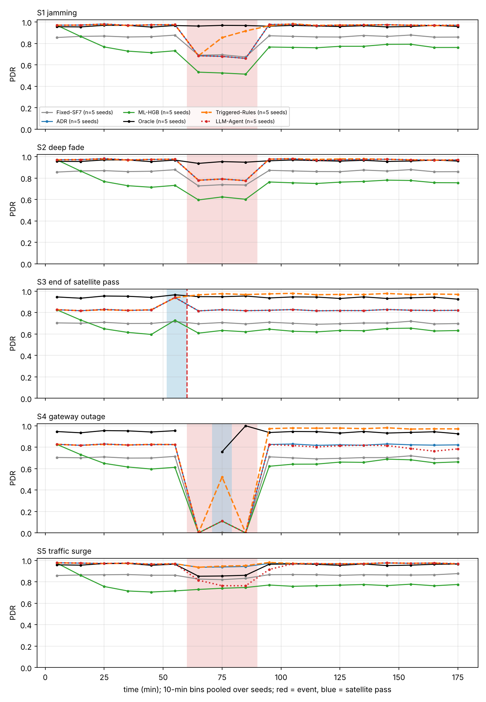
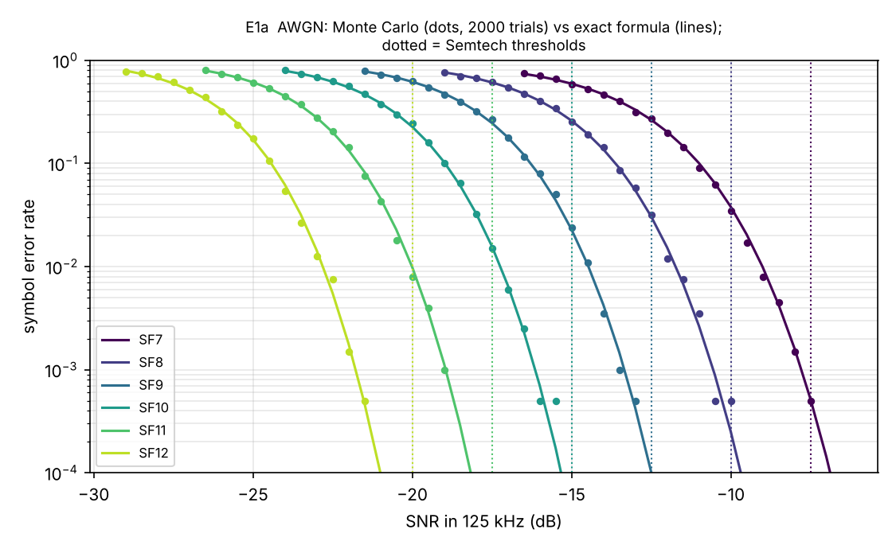
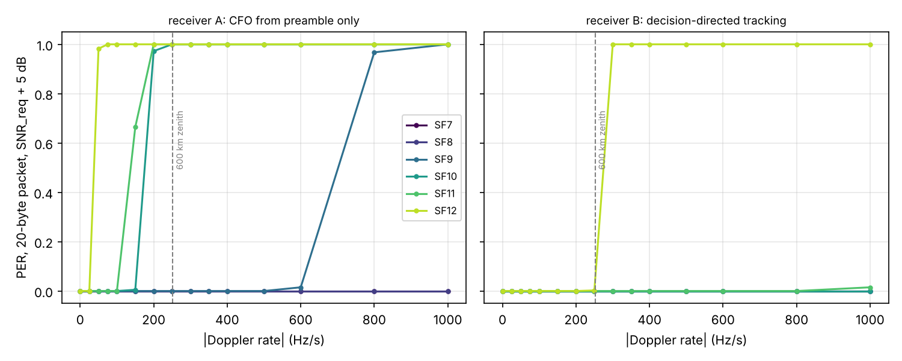
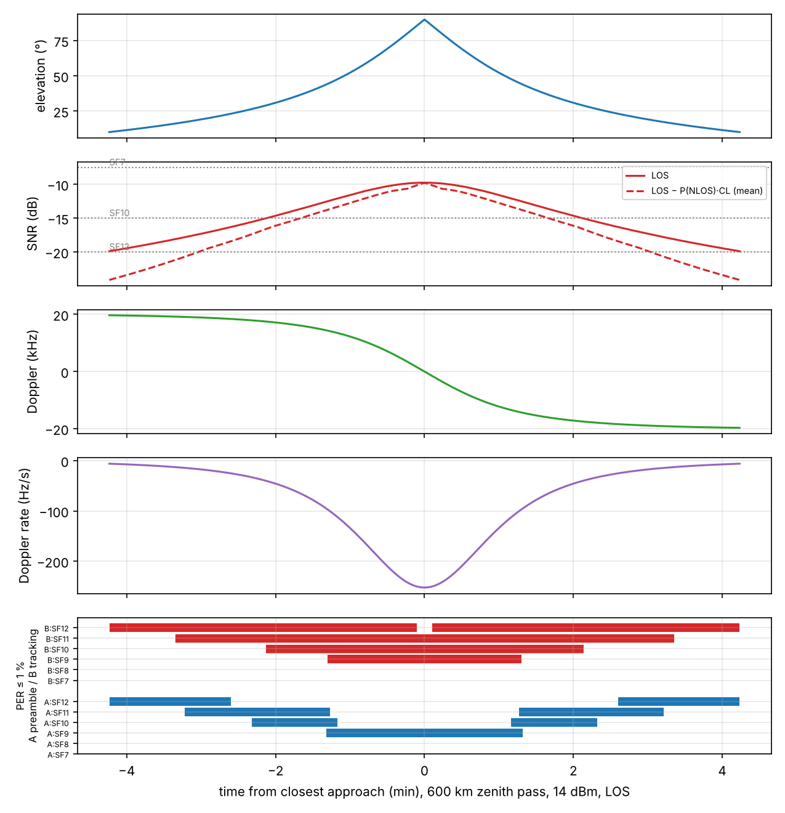
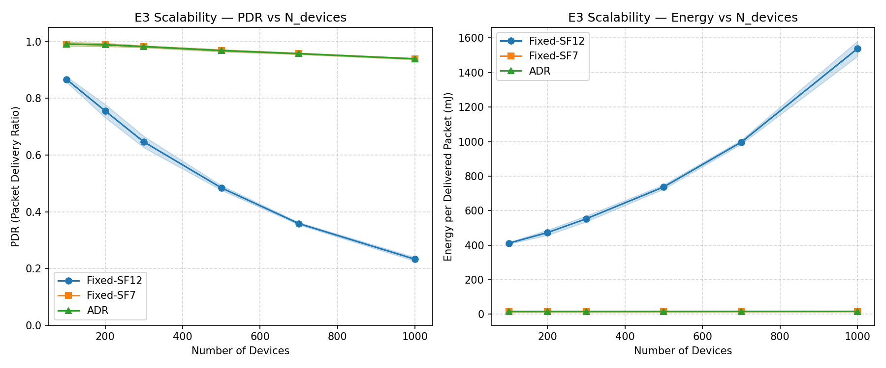
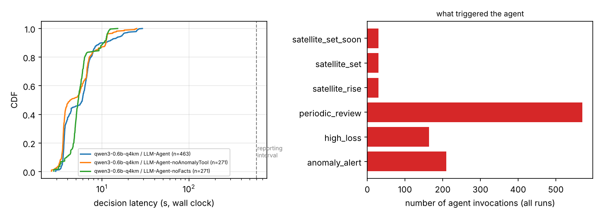
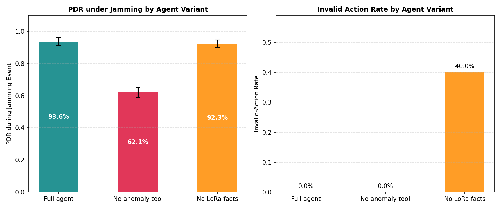

# llm-lora-ntn-agent

**Event-triggered LLM agent for LoRa parameter control (SF, power, channels, link) in a hybrid
terrestrial + LEO-satellite IoT network: a Doppler-aware simulation study with honest baselines.**
Runs on a laptop CPU: no radio hardware, no GPU.



*E4 — packet delivery ratio (10-min bins, pooled over 5 seeds) around five events. Red: event;
blue: satellite pass. Generated by `experiments/e4_anomalies.py --plot-only` from `results/e4_timeseries.csv`.*

<!-- KEY-RESULTS:START -->
## Key findings

1. **The Doppler *rate*, not the Doppler shift, decides which SF survives a LEO pass, and the answer
   depends on the receiver.** Without frequency tracking, SF12 packets fail from 50 Hz/s and no single
   SF works over a whole 600 km pass. With decision-directed tracking, SF12 fails only near zenith
   (300 Hz/s); the model puts the SF12 limit at about 650 km of altitude, against ~550 km measured on
   a CubeSat (Doroshkin et al., 2019).
2. **The event-triggered architecture is worth about ten points.** A rule-based controller on the
   same triggers, telemetry and leased overrides as the agent beats ADR by +10.5 (jamming), +15.0
   (end of pass) and +12.9 points (gateway outage) of packet delivery ratio, on 5/5 paired seeds.
3. **A 0.6B LLM agent does not clear that bar.** Qwen3-0.6B read the network correctly but acted 6
   times in 287 decisions: identical to ADR in S1–S3, and −17.5 ± 23.9 points in the traffic surge,
   where on 2/5 seeds it moved every device to SF12. The action passed schema validation:
   validated is not safe.
4. **Latency is not the bottleneck.** 5.78 s median per decision on 2 CPU threads, 7.65 LLM calls
   per simulated hour; the class-A control plane (a command waits for the device's next uplink, up to
   10 min) dominates the reaction time.
5. **Honest baselines matter.** The per-packet oracle is not an upper bound under heavy load
   (89.4 % vs ADR 95.4 % at 1000 devices), and a classifier imitating it under-provisions.

> Agent results come from Qwen3-0.6B (llama.cpp) because Ollama was not reachable where the
> experiments were run. The reference model of the protocol, `qwen2.5:3b`, runs with the same
> scripts: see [Reproduce](#reproduce).
<!-- KEY-RESULTS:END -->

## Research question

Can an LLM agent that reads network telemetry and calls control tools choose LoRa transmission
parameters better than ADR and an ML classifier trained on oracle labels, especially during events
the rules do not anticipate (jamming, deep fade, end of a satellite pass, gateway outage, traffic
surge)? What does it cost in decision latency?

## What is modelled

| Layer | Model | Code |
|---|---|---|
| PHY | CSS modem; packet-level Monte Carlo under AWGN + Doppler **rate** over the whole packet; two receivers: A (frequency offset from the preamble only) and B (decision-directed tracking); reduced-rate symbols; PER tables `PER(SF, SNR, \|rate\|)` | `phy/` |
| Terrestrial channel | Okumura–Hata rural, 7 dB shadowing per device + 3 dB per packet | `channel/terrestrial.py`, `channel/link_budget.py` |
| Satellite channel | closed-form LEO pass for any maximum elevation (600 km), FSPL, Doppler and Doppler rate, 3GPP TR 38.811 LOS probability / shadowing / clutter (S-band rural, used at 868 MHz) | `channel/satellite.py` |
| Network | event-driven, pure ALOHA per gateway with 6 dB capture, orthogonal SFs, 1 % duty cycle per device on sub-band g1, channel hopping, SX1276 energy model, **class-A control plane** (+ satellite broadcast during passes), **common random numbers** across policies | `netsim/` |
| Events | jamming, deep fade, end of pass, gateway outage, traffic surge; rolling z-score detector on network-server data | `netsim/anomalies.py` |
| Policies | Fixed SF7, Fixed SF12, ADR (Semtech rule), ML-HGB (oracle labels), Oracle (upper bound), **Triggered-Rules** (same triggers as the agent, hand-written rules), **LLM agent** (5 tools, guardrails, leases, ADR fallback) | `policies/` |

Every simplification is listed in [`docs/ASSUMPTIONS.md`](docs/ASSUMPTIONS.md); departures from
the original plan and their reasons are in [`docs/ARCHITECTURE.md`](docs/ARCHITECTURE.md).

## Results

All numbers below are copied from [`results/summary.md`](results/summary.md), which
`experiments/summarize.py` generates from the CSV files. Mean ± standard deviation over 5 seeds.

<!-- RESULTS:START -->
### E1 — PHY validation ([`e1_phy_validation.py`](experiments/e1_phy_validation.py))

| | |
|---|---|
|  |  |

- Monte Carlo SER vs exact noncoherent formula: max absolute difference 0.0203 (126 points, 2000 trials each).
- Ideal receiver, 20-byte packet: PER = 1 % between −1.4 dB (SF12) and +0.32 dB (SF7) from the Semtech thresholds; no calibration applied.
- Doppler rate at which PER exceeds 10 % (SNR_req + 5 dB):

| receiver | SF7 | SF8 | SF9 | SF10 | SF11 | SF12 |
|---|---|---|---|---|---|---|
| A, preamble only | >1000 | >1000 | 800 | 200 | 150 | 50 |
| B, tracking | >1000 | >1000 | >1000 | >1000 | >1000 | 300 |

### E2 — LEO pass ([`e2_satellite_pass.py`](experiments/e2_satellite_pass.py))



600 km zenith pass: 508 s above 10°, |Doppler| up to 19 707 Hz, |Doppler rate| up to 252.3 Hz/s,
delay 2.00–6.42 ms, LOS SNR −19.9 to −9.8 dB at 14 dBm. Share of the pass with PER ≤ 1 % at 600 km:
SF12 0.39 (receiver A) vs 0.98 (receiver B). Altitude sweep: [`e2b_altitude_sweep.png`](results/e2b_altitude_sweep.png).

### E3 — Scalability, no anomaly ([`e3_scalability.py`](experiments/e3_scalability.py))



| policy | PDR % N=100 | PDR % N=1000 | mJ / delivered N=100 | mJ / delivered N=1000 |
|---|---|---|---|---|
| Fixed-SF7 | 86.7 ± 3.0 | 84.8 ± 0.8 | 6.6 ± 0.2 | 6.7 ± 0.1 |
| Fixed-SF12 | 90.4 ± 1.3 | 41.9 ± 0.6 | 146.8 ± 2.1 | 317.0 ± 4.4 |
| ADR | 97.5 ± 0.6 | 95.4 ± 0.2 | 16.1 ± 2.4 | 15.7 ± 0.7 |
| ML-HGB | 76.3 ± 1.6 | 75.4 ± 0.3 | 9.9 ± 1.4 | 9.3 ± 0.4 |
| Triggered-Rules | 97.5 ± 0.7 | 95.4 ± 0.2 | 16.1 ± 2.4 | 15.7 ± 0.7 |
| LLM-Agent (Qwen3-0.6B) | 97.5 ± 0.6 | 93.3 ± 4.6 | 16.1 ± 2.4 | 20.6 ± 10.9 |
| Oracle | 98.1 ± 0.3 | 89.4 ± 0.2 | 9.1 ± 1.2 | 9.2 ± 0.3 |

Pure-ALOHA check: max |S_sim − G·e^(−2G)| = 0.0026 up to G = 1.03.
The agent equals ADR up to N = 200 and is below it in 7 of its 30 runs at higher load (worst seed
−15.5 points at N = 800): each time a false detector alert coincided with a periodic review and it
moved every device to SF12. Over E3 and E4, 15 of its 16 applied changes were that same action.

### E4 — Anomaly scenarios ([`e4_anomalies.py`](experiments/e4_anomalies.py))

Event at t = 1 h, 30 min long (S3: pass ends at 1 h), 3 h runs, N = 300, 5 paired seeds.
PDR (%) in the event window [start, end + 10 min]:

| policy | S1 jamming | S2 deep fade | S3 pass end | S4 gateway outage | S5 traffic surge |
|---|---|---|---|---|---|
| Fixed-SF7 | 73.3 ± 1.3 | 76.8 ± 2.0 | 69.9 ± 1.6 | 18.0 ± 0.6 | 82.8 ± 1.9 |
| Fixed-SF12 | 72.3 ± 1.3 | 72.7 ± 1.1 | 66.6 ± 1.3 | 19.2 ± 0.5 | 43.3 ± 0.9 |
| ADR | 75.1 ± 0.8 | 83.1 ± 0.5 | 82.0 ± 1.3 | 23.5 ± 0.3 | 94.1 ± 0.4 |
| ML-HGB | 58.4 ± 1.4 | 64.6 ± 2.1 | 62.1 ± 2.5 | 18.4 ± 0.8 | 74.0 ± 0.8 |
| Triggered-Rules | 85.6 ± 1.8 | 83.1 ± 0.5 | 97.1 ± 0.5 | 36.5 ± 0.6 | 94.6 ± 0.4 |
| LLM-Agent (Qwen3-0.6B) | 75.1 ± 0.8 | 83.1 ± 0.5 | 82.0 ± 1.3 | 23.5 ± 0.4 | 76.6 ± 23.9 |
| Oracle | 96.5 ± 0.8 | 95.0 ± 0.9 | 95.1 ± 1.5 | 85.8 ± 1.5 | 86.3 ± 0.5 |

Paired difference to ADR (points, seeds better/5): Triggered-Rules +10.5 (5), +0.0 (0), +15.0 (5),
+12.9 (5), +0.5 (5); LLM-Agent +0.0, +0.0, +0.0, −0.1, −17.5 ± 23.9 (0/5 better, 2/5 worse).
Energy, recovery time, reading delivery ratio and detector precision/recall: [`results/summary.md`](results/summary.md),
figure [`e4_event_bars.png`](results/e4_event_bars.png).

### E5 — Cost of the agent ([`e5_agent_cost.py`](experiments/e5_agent_cost.py))



Qwen3-0.6B Q4_K_M, llama.cpp, 2 CPU threads, E4 runs: 287 decisions in 25 runs; 7.65 LLM calls per
simulated hour; decision latency median 5.78 s, p95 14.67 s; 11 `set_tx_params` calls, 5 rejected
(invalid-action rate 0.455, all "target group is empty"); 0 read-before-write violations, 0 backend
fallbacks.

<!-- E6:START -->
### E6 — Ablations ([`e6_ablations.py`](experiments/e6_ablations.py))



| policy (Qwen3-0.6B) | S1 jamming | S2 deep fade | S3 pass end | S4 gateway outage | S5 traffic surge |
|---|---|---|---|---|---|
| ADR | 75.1 ± 0.8 | 83.1 ± 0.5 | 82.0 ± 1.3 | 23.5 ± 0.3 | 94.1 ± 0.4 |
| LLM-Agent | 75.1 ± 0.8 | 83.1 ± 0.5 | 82.0 ± 1.3 | 23.5 ± 0.4 | 76.6 ± 23.9 |
| without anomaly tool | 75.1 ± 0.8 | 83.1 ± 0.5 | 82.0 ± 1.3 | 23.5 ± 0.3 | 94.1 ± 0.4 |
| without LoRa facts | 75.1 ± 0.8 | 83.1 ± 0.5 | 82.0 ± 1.3 | 23.5 ± 0.3 | 94.1 ± 0.4 |

Neither ablation ever called `set_tx_params` (0 calls in 271 decisions each), so both equal ADR and
avoid the surge failure. With a 0.6B model the ablations measure the propensity to act, not the value
of the information; they must be repeated with 3B/7B models.
<!-- E6:END -->
<!-- RESULTS:END -->

## Reproduce

Python 3.11+.

```bash
python -m venv .venv && source .venv/bin/activate     # Windows: .venv\Scripts\activate
pip install -r requirements.txt
python -m pytest -q                                   # 60 tests
```

Everything, in order (PHY tables are committed; regenerate with `python -m phy.ser_montecarlo --receiver tracking|preamble`, ~30 min each):

```bash
ollama pull qwen2.5:3b
bash experiments/run_all.sh qwen2.5:3b
```

Or step by step (each script is resumable and has `--plot-only` to redraw figures from the CSV):

```bash
python experiments/e1_phy_validation.py
python experiments/e2_satellite_pass.py
python experiments/e3_scalability.py                    # baselines + pure-ALOHA check
python experiments/e4_anomalies.py                      # baselines (trains the ML model once)
python experiments/e4_anomalies.py --policies LLM-Agent --backend ollama --model qwen2.5:3b
python experiments/e6_ablations.py --backend ollama --model qwen2.5:3b
python experiments/e5_agent_cost.py                     # from the agent traces
python experiments/summarize.py                         # results/summary.md
python report/make_numbers.py                           # report/numbers.tex
```

Agent answers are cached (`results/llm_cache/`), keyed by the full prompt: with temperature 0 and
a fixed seed, re-running replays the same answers and their originally measured latencies.
`--replay-only` regenerates every agent result without the model.

Without Ollama, the in-process backend runs any GGUF file:
`--backend llamacpp --model <label> --model-path <file.gguf>` (needs `pip install llama-cpp-python`).

## Repository layout

```
configs/      base.yaml + one file per scenario (s1–s5, e3)
phy/          css.py, receiver.py (packet-level Doppler), ser_montecarlo.py, tables/*.npz
channel/      terrestrial.py, satellite.py (pass geometry, TR 38.811), link_budget.py
netsim/       simulator.py, devices.py, anomalies.py (events + detector), energy.py, config.py
policies/     fixed, adr, ml_classifier, oracle, rules, triggers, llm_agent/{agent,tools,prompt,backends}
experiments/  e1…e6, summarize.py, run_all.sh
results/      CSV, PNG, summary.md, traces/ (every agent decision), llm_cache/, ml/
report/       IEEE-format report (main.tex, sections/, numbers.tex generated from the CSV)
docs/         PROJECT_SPEC.md (plan), ARCHITECTURE.md, ASSUMPTIONS.md, PROTOCOL.md
tests/        pytest suite (PHY, channel, simulator, policies, agent plumbing)
```

## References

- L. Vangelista, "Frequency Shift Chirp Modulation: The LoRa Modulation," *IEEE SPL*, 2017.
- A. A. Doroshkin et al., "Experimental Study of LoRa Modulation Immunity to Doppler Effect in CubeSat Radio Communications," *IEEE Access*, vol. 7, 2019.
- 3GPP TR 38.811 V15.1.0, *Study on NR to support non-terrestrial networks*, tables 6.6.1-1 and 6.6.2-3.
- Semtech, SX1276 datasheet (Table 6, supply current in transmit mode); LoRa Modem Designer's Guide AN1200.13.
- M. Bor et al., "Do LoRa Low-Power Wide-Area Networks Scale?," *ACM MSWiM*, 2016.
- J. A. Fraire, S. Céspedes, N. Accettura, "Direct-to-Satellite IoT — A Survey," *ADHOC-NOW*, 2019.
- S. Yao et al., "ReAct," *ICLR*, 2023.

## License

MIT (see `LICENSE`).
